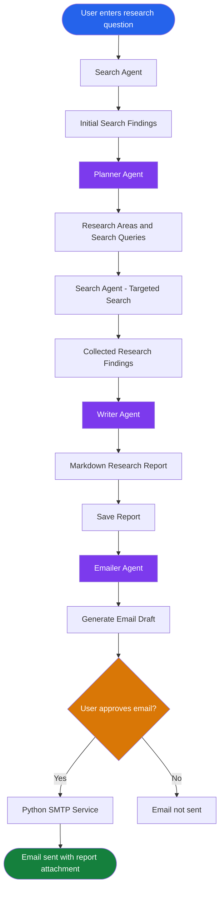

# Deep Research Agent

A Python-based multi-agent application that takes a research question, searches the web, organizes the findings, and generates a research report.

I built this project to get hands-on experience with the OpenAI Agents SDK, tool calling, agent orchestration, structured outputs, and building an application around LLMs.


The application also generates an email draft with the report attached. The email is sent only after the user reviews and approves it.

## What it does?

You enter a research topic and an email address. The application then:

1. Searches the web for initial information using Tavily.
2. Passes the findings to a Planner Agent, which breaks the topic into smaller research areas and generates search queries.
3. Uses the Search Agent again to collect more focused information.
4. Passes the collected results to the Writer Agent to generate a research report.
5. Saves the report as a Markdown file.
6. Uses the Emailer Agent to prepare an email draft.
7. Displays the draft for review. The email is sent only when the user approves it.

## How the agents work together?

I kept the agents focused on individual tasks and used a Python pipeline to control the order in which they run. There are no agent-to-agent handoffs in this implementation.



### Agents

| Agent | What it does |
|---|---|
| Search Agent | Searches the web using Tavily. It is used for both initial and targeted searches. |
| Planner Agent | Creates research areas and search queries based on the initial findings. |
| Writer Agent | Turns the collected search results into a structured report. |
| Emailer Agent | Prepares an email using the research report. |

The actual email sending is handled by a separate Python function, not by the Emailer Agent. This allows the user to review the draft before anything is sent.

## A few implementation details

**Search and tool calling**

The Search Agent uses a custom Tavily function tool to retrieve web results. I used Tavily instead of a hosted web search tool because of compatibility issues with Gemini's OpenAI-compatible API.

**Structured outputs**

I use Pydantic models for outputs such as the research plan, search results, report, and email draft.

One implementation detail worth mentioning: Gemini returned an error when I combined tool calling with native JSON structured output. To work around this, I separated the search agent's tool-calling step from the structured-output generation step. The other agents use a separate helper to generate and validate JSON responses against Pydantic schemas.

**Report generation**

The Writer Agent generates a short summary, a detailed Markdown report, and follow-up questions. Each report is saved with a timestamp so that multiple research runs don't overwrite one another.

**Email approval**

The Emailer Agent only generates the draft. A separate SMTP service sends the email after the user approves it. The generated Markdown report is attached to the email.

**Progress tracking and tracing**

The Gradio interface displays progress as the pipeline moves through its stages. I also enabled OpenAI Agents SDK tracing to inspect agent execution.

## Tech Stack

- Python
- Google Gemini 2.5 Flash
- OpenAI Agents SDK
- Tavily Search API
- Pydantic
- Gradio
- SMTP
- uv
- Render

## Project Structure

```text
deep-research-agent/
│
├── my_agents/
│   ├── search_agent.py
│   ├── planner_agent.py
│   ├── writer_agent.py
│   └── emailer_agent.py
│
├── tools/
│   ├── web_search.py
│   └── email_tool.py
│
├── models/
│   └── schemas.py
│
├── utils/
│   ├── structured_output.py
│   └── report_saver.py
│
├── reports/
│
├── app.py
├── research_pipeline.py
├── email_service.py
├── config.py
├── test_pipeline.py
│
├── pyproject.toml
├── uv.lock
└── README.md
```

## Running locally

### 1. Clone the repository

```bash
git clone https://github.com/Priyanka06yadav/deep-research-agent.git

cd deep-research-agent
```

### 2. Install dependencies

I used `uv` to manage the project environment and dependencies.

```bash
uv sync --frozen
```

### 3. Set up environment variables

Create a `.env` file in the project root:

```env
GEMINI_API_KEY=your_gemini_api_key
TAVILY_API_KEY=your_tavily_api_key
OPENAI_API_KEY=your_openai_api_key

SMTP_HOST=smtp.gmail.com
SMTP_PORT=587
SMTP_USERNAME=your_email@gmail.com
SMTP_PASSWORD=your_gmail_app_password
```

The OpenAI API key is used for Agents SDK tracing. Gemini is the model provider used by the agents.

For Gmail, use an App Password instead of your regular account password.

### 4. Start the application

```bash
uv run python app.py
```

Open the Gradio URL printed in the terminal.

## Deployment

The application is configured to run on Render.

**Build command**

```bash
uv sync --frozen
```

**Start command**

```bash
uv run python app.py
```

The following environment variables need to be configured in the Render dashboard:

`GEMINI_API_KEY`, `TAVILY_API_KEY`, `OPENAI_API_KEY`, `SMTP_HOST`, `SMTP_PORT`, `SMTP_USERNAME`, and `SMTP_PASSWORD`.

Note: Reports are currently saved to the local `reports/` directory. Render's default filesystem is ephemeral, so generated files are not guaranteed to remain available after a restart or redeployment.

## What I learned?

Building this project helped me understand a few things beyond simply calling an LLM API:

- How to divide a larger task between specialized agents.
- How to orchestrate agents using a Python pipeline.
- How function tools work and how agents decide when to use them.
- How to validate LLM responses using Pydantic.
- How to handle API compatibility issues when working with different model providers.
- How to introduce human approval into an AI workflow.
- How to connect an AI application to external services such as Tavily and SMTP.
- How to build and deploy a Gradio application.
